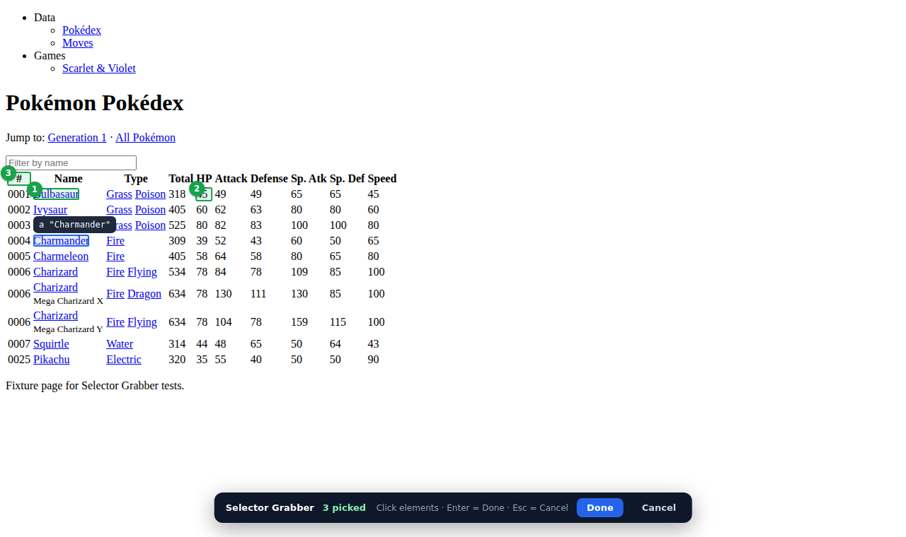
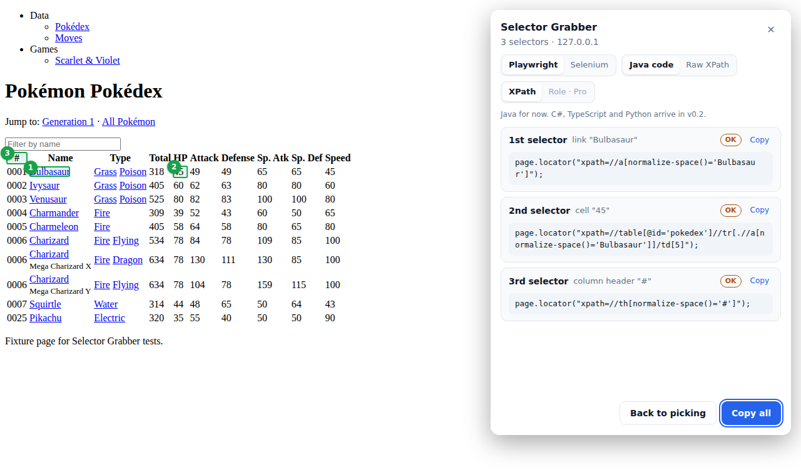

# Selector Grabber

Click elements on any page, press **Done**, and copy unique, relative XPath selectors for **Playwright** or **Selenium**, ready to paste into Java.

Built for Brave first, and it works the same in Chrome. It works on the first click on tabs that were already open: no reload, no DevTools.




## Try it in Brave (no build needed)

1. Download `selector-grabber-extension-v0.1.0.zip` from the [Releases](../../releases) page (or build it, below) and unzip it.
2. Open `brave://extensions` (in Chrome: `chrome://extensions`).
3. Turn on **Developer mode** (top right).
4. Click **Load unpacked** and choose the unzipped folder (the one that contains `manifest.json`).
5. Click the puzzle-piece icon in the toolbar and pin **Selector Grabber**.

## Use it

1. Open any web page and click the Selector Grabber icon.
2. Click the elements you want. Each gets a green numbered badge. Click one again to remove it.
3. Press **Enter** or click **Done**.
4. Pick **Playwright** or **Selenium**, and **Java code** or **Raw XPath**.
5. Click **Copy all**, or **Copy** on a single card.

**Esc** cancels at any time. Clicking the icon again also turns the picker off. While picking, clicks on the page are captured, so clicking a link picks it instead of following it.

Example output:

```java
// 1st selector: link "Bulbasaur"  [OK]
page.locator("xpath=//a[normalize-space()='Bulbasaur']");
// 2nd selector: cell "45"  [OK]
page.locator("xpath=//table[@id='pokedex']//tr[.//a[normalize-space()='Bulbasaur']]/td[5]");
```

## How it picks a selector

For each element the engine climbs a ladder, most stable first, and keeps the first XPath that matches exactly that one element on the live page. It never emits an absolute path like `/html/body/div[3]`.

| Rung | Strategy | Example | Label |
| --- | --- | --- | --- |
| 1 | Test attribute (`data-testid`, `data-test`, `data-qa`, `data-cy`) | `//button[@data-testid='login-submit']` | Strong |
| 2 | Stable `id` | `//table[@id='pokedex']` | Strong |
| 3 | `name` on form fields | `//select[@name='region']` | Strong |
| 4 | `aria-label`, `placeholder`, `title`, `alt`, or the field's `<label>` | `//input[@id=//label[normalize-space()='Email']/@for]` | Strong |
| 5 | Exact visible text (40 characters or fewer) | `//a[normalize-space()='Charmander']` | OK |
| 6 | Link path | `//a[@href='/pokedex/bulbasaur']` | OK |
| 7 | Two attributes together, or inside a uniquely located ancestor, or the repeated row or card found by its text | `//div[@id='root']//div[.//h3[normalize-space()='Red mug']]/button` | OK |
| 8 | Position under the nearest anchor (last resort) | `(//div[@id='root']//span)[2]` | Fragile |

Other rules:

- Generated values are skipped: `ember123`, `:r1:`, `css-1x2y3z`, `sc-AxjAm`, `product-card-4821`, UUIDs.
- `normalize-space()` is used instead of `text()`, because `text()='X'` fails when text is split by a child tag or padded with whitespace.
- Text containing both `'` and `"` is written with `concat()`, the only way XPath 1.0 can express it.
- SVG elements use `*[local-name()='path']`, because SVG lives in its own namespace.
- Every pick is checked again when you press Done, in case the page changed after the click.

## Privacy

Selector Grabber makes no network requests. The picks travel from the page to the results panel through the extension's local storage and are deleted when the panel closes. The panel is an extension page in an iframe, so the site cannot read it.

## Permissions

| Permission | Why |
| --- | --- |
| `activeTab` | Access to the tab you clicked the icon on, only at that moment. No "read all your data" warning at install. |
| `scripting` | Injects the picker into that tab. |
| `storage` | Hands picks to the results panel and remembers your framework choice. |

## Development

Requires [Node.js](https://nodejs.org/) 20 or newer.

```bash
npm install          # once
npm run build        # builds the extension into dist/
npm test             # unit tests for the pure functions (Vitest)
npm run test:e2e     # engine tests + the built extension driven in real Chromium (Playwright)
npm run typecheck    # TypeScript checks
```

After changing code, run `npm run build`, then click the reload arrow on the Selector Grabber card in `brave://extensions`.

The first time you run the browser tests, install Playwright's Chromium: `npx playwright install chromium`.

### Project layout

```
src/
  background.ts      service worker: icon click, blocked-page check, injection
  picker/            overlay in a closed shadow root: highlight, badges, Done bar
  panel/             results panel (extension page shown in an iframe)
  blocked/           popup that explains pages extensions cannot run on
  engine/            locator engine (no Chrome APIs; runs in any DOM)
  format/            Java output for Playwright and Selenium
test/
  unit/              Vitest: XPath literals, generated-value detection, formatter
  engine/            Playwright: engine on fixture pages, plus the uniqueness property test
  e2e/               Playwright: the built extension loaded into Chromium
  fixtures/          hand-built test pages
```

### Testing notes

- **The engine is tested in real Chromium, not jsdom.** jsdom's XPath implementation fails on expressions the engine emits. Chromium's is what users get.
- **Property test.** On every fixture page, every element gets an XPath that matches it and only it, and none is absolute.
- **E2E build.** Tests cannot click the browser toolbar, so they call the same `activate()` function from the service worker. `npm run build:e2e` writes `dist-e2e/` with an extra host permission for that. Never ship `dist-e2e/`.
- **Keyboard-driven panel.** Playwright cannot compute mouse positions inside an iframe that sits in a closed shadow root, so the tests use focus and key presses. That doubles as a keyboard-accessibility check.

## Roadmap

- **v0.1** (this): picker, results panel, engine rungs 1–8, Java output, Copy all.
- **v0.2**: C#, TypeScript and Python output; SVG and iframe improvements; shadow DOM.
- **v0.3**: public launch on the Chrome Web Store (installs in Brave and Chrome), free with ads shown only inside the extension.
- **v1.0 Pro**: no ads; Role and CSS locators.
- **v1.2 Pro**: selection-set export for Page Builder, explain mode, saved-set health checks.

## License

Not chosen yet. Until a license is added, the code is visible but all rights are reserved.
